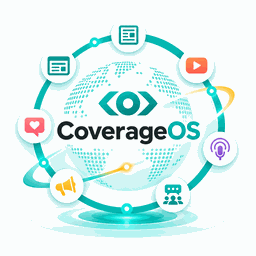

# CoverageOS

<p align="center">
  
</p>

# CoverageOS

An AI plus human layer that watches the health and completeness of our content supply chain. It finds blind spots before customers do, ranks what to fix first, repairs sources, and proves the result.

**Live demo:** https://thangaperumal-mw.github.io/CoverageOS/

> Meltwater hackathon prototype. Every internal value (Atlas state, ARR, tickets, scores, impact, revenue) is illustrative or modeled and is **not** Meltwater production data. Only the Trends Center evidence and public source identities are real, and the interface tags each figure so a reader always knows which is which.


## The idea

Meltwater's capabilities only know what Meltwater ingests. A missing, stale or broken source is invisible until a customer notices, and then it shows up in Explore, Trends, Analyze, Media Relations, GenAI Lens and MCP all at once.

CoverageOS closes the loop: **detect, prioritize, discover, diagnose, repair, human review, verify, measure, learn.**

## Five phases, one gap

The demo follows a single case, `GAP-IN-TAM-SOC-AUTO-0307` (India, Tamil, social media, automotive), through every phase. The same Gap ID is carried end to end.

| Phase | Question it answers | Key mechanics |
|---|---|---|
| **1. Coverage Intelligence** | Where are we weak, and what should we fix first? | Interactive world map, Coverage Health Score, 7-weight Opportunity Score, drill-down to the blind spot |
| **2. SourceScout** | Which source should we add, fix, watch or reject? | 7-factor ranking, Atlas de-duplication, ADD / FIX / WATCH / REJECT, projected lift |
| **3. Source Doctor** | What is broken, and what is the safest repair? | 8-cause diagnostic engine, auto-fix gates, five routes, repair lifecycle |
| **4. Human-in-the-Loop** | Which cases need a person, and what do we learn? | Impact-ordered queue, six decision actions, structured learning records |
| **5. Product & Revenue Impact** | What value did better coverage create? | Before and after, product impact map, MCP evidence, operations, modeled revenue |

| | |
|---|---|
|  |  |
|  |  |

## Try it in three minutes

1. **Overview.** Watch the Gap ID travel through the five phases, then choose **Start the guided demo**.
2. **Phase 1.** Click Finland (very thin), then India. Choose **Automotive** in the coverage genome to open the blind spot.
3. **Phase 2.** MotoWagon is a FIX: it already exists but is unhealthy, so it is routed to repair instead of a duplicate ADD.
4. **Phase 3.** Article discovery failure at 88% confidence. Two auto-fix gates are not met, so a person reviews it.
5. **Phase 4.** Choose **Approve fix** and **Capture decision** to create a structured learning record.
6. **Phase 5.** Compare before and after, click a capability on the impact map, and read the modeled revenue.

A fuller presenter guide is in [docs/DEMO_SCRIPT.md](docs/DEMO_SCRIPT.md).

## Run locally

The site is plain HTML, CSS and JavaScript with no build step. Pages fetch JSON, so serve the folder rather than opening files directly.

```bash
python -m http.server 8080
```

Then open <http://localhost:8080>. Launchers are included: `start_windows.bat` and `start_mac_linux.sh`.

## Publish on GitHub Pages

1. Push this folder to the `main` branch.
2. In the repository, open **Settings, Pages**.
3. Under **Build and deployment**, choose **Deploy from a branch**, select `main` and the `/ (root)` folder, then save.
4. After a minute the site is live at `https://<user>.github.io/CoverageOS/`.

All paths are relative, so the site works on a Pages project URL. `.nojekyll` is included so files are served as they are.

## Repository layout

```text
index.html                 Overview and entry point
data/pipeline.json         Canonical data contract for all phases
shared/                    Design system (styles.css), app shell, landing script, favicon
phase1/ ... phase5/        One folder per phase: index.html and app.js
phase1/data/               country-data.json and world.geojson for the map
docs/                      HANDOVER.md, DEMO_SCRIPT.md, DATA_MODEL.md, screenshots
scripts/validate.mjs       Checks the data contract and links
.github/workflows/         CI that runs the validation on every push
```

## Data discipline

| Real or supplied | Modeled |
|---|---|
| Trends Center results for ten countries | Atlas state, ARR, ticket counts |
| Public source names and domains | SourceScout scores and confidence |
| The workflow context | Diagnostic evidence and recovery |
| | Coverage lift, product impact, revenue and ROI |

Never present modeled values as measured. Use "modeled", "prototype" or "illustrative". Details are in [docs/DATA_MODEL.md](docs/DATA_MODEL.md).

## Validate

```bash
node scripts/validate.mjs
```

The script checks that weights sum to 100, every score equals its weighted factors, Doctor routes follow from the gates, the numbers reconcile across all five phases, and every relative link resolves. It runs automatically in CI.

## Design

Meltwater-style light theme: Meltwater teal `#28BBBB` as the anchor, dark teal `#1C7070` for text and actions, and orange and yellow reserved for risk and priority. Poppins is used as the approved digital stand-in for GT Walsheim. Headlines use sentence case. Tuned for roughly 90% browser zoom, with keyboard focus, reduced-motion support and a responsive layout.

The CoverageOS mark is a placeholder. Official Meltwater logo files should be added by the brand owner and used under the brand guidelines.

## Working on this project

- Keep the five-phase architecture, phase names and the persistent Gap ID unless the project owner changes them.
- Keep SourceScout (which source) and Source Doctor (what is broken) separate.
- Keep HITL as a structured learning-data layer, not a ticket list.
- Change numbers in `data/pipeline.json`, then run `node scripts/validate.mjs`.
- Do not fabricate internal states, ARR, tickets or impact as fact. If a workflow detail is unverified, say so.

## Status

Prototype built for a Meltwater internal hackathon. Concepts considered for later: Coverage Diversity Index, Source Value Score, Content Black Holes, Source Twin, MCP and Trend Coverage Guards, Live Event Coverage Booster, and a Ticket-to-Signal loop. See [docs/HANDOVER.md](docs/HANDOVER.md).


**Hackathon prototype — complete five-phase integrated demo.**

The current build is intentionally optimized for stakeholder demonstration rather than production deployment. Productionization would require governed connectors to internal source master, support/ticket, ingestion, GenAI citation and customer-value systems, plus calibrated scoring and authorization controls.
