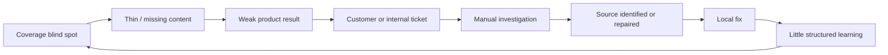
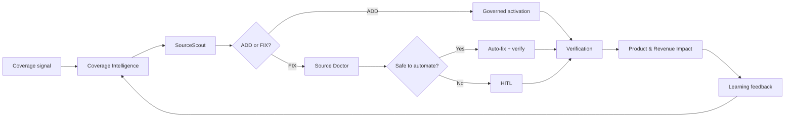
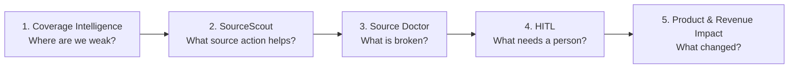
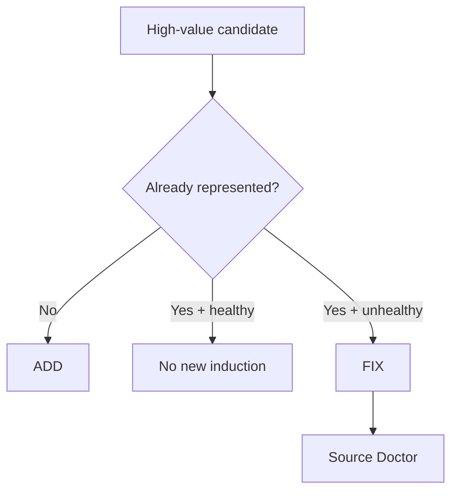
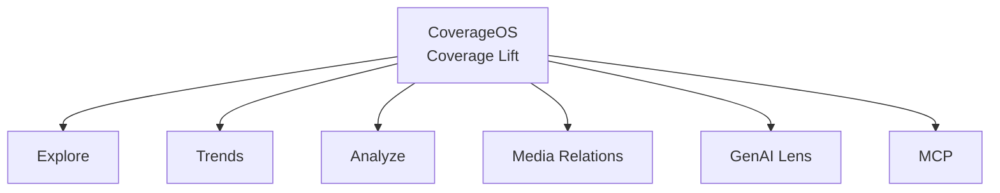
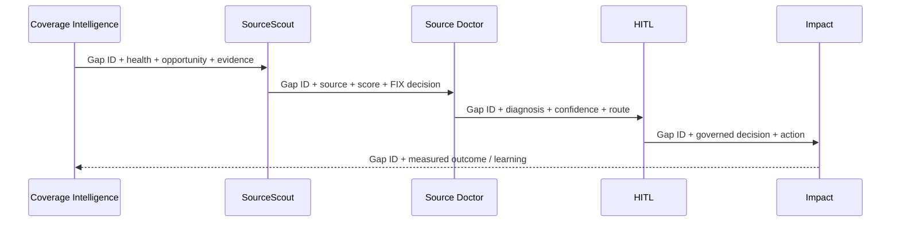
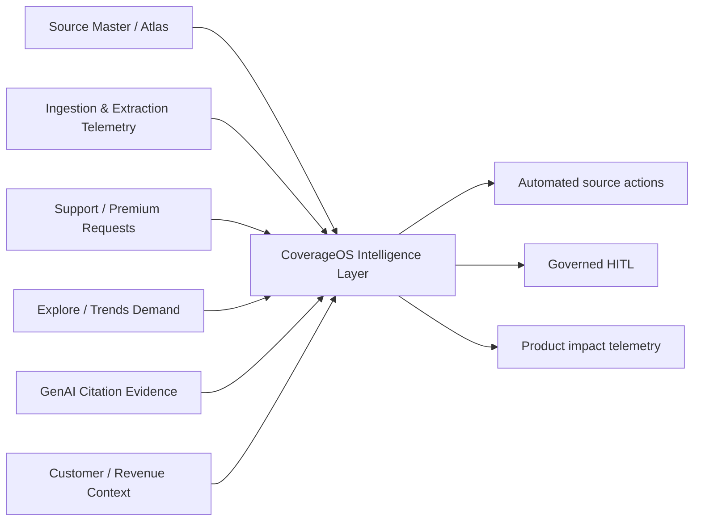

<p align="center">
  
</p>

<h1 align="center">CoverageOS</h1>

<p align="center">
  <strong>AI-powered global coverage intelligence and self-healing for Meltwater's content ecosystem</strong>
</p>

<p align="center">
  Detect blind spots before customers do. Discover what is missing. Diagnose what is broken. Route the right work to humans. Prove the downstream product and business impact.
</p>

<p align="center">
  <a href="https://thangaperumal-mw.github.io/CoverageOS/"><strong>▶ Open Live Demo</strong></a>
  &nbsp;•&nbsp;
  <a href="phase1/index.html">Coverage Intelligence</a>
  &nbsp;•&nbsp;
  <a href="phase2/index.html">SourceScout</a>
  &nbsp;•&nbsp;
  <a href="phase3/index.html">Source Doctor</a>
  &nbsp;•&nbsp;
  <a href="phase4/index.html">HITL</a>
  &nbsp;•&nbsp;
  <a href="phase5/index.html">Impact</a>
</p>

---

> [!IMPORTANT]
> **Hackathon prototype — data discipline matters.**  
> Public source identities and the supplied Trends Center evidence are real inputs used by the prototype. Internal system states, Atlas/Nitro status, scores, confidence, ARR, ticket counts, projected coverage lift, product impact, financial impact and ROI are **illustrative / modeled prototype values** unless explicitly stated otherwise. They must not be presented as production Meltwater measurements.

---

## 01 — The 30-second idea

Meltwater products are only as strong as the content they can see.

A source can be missing, unhealthy, stale, misconfigured, blocked, incorrectly mapped or silently failing long before anyone notices. When that happens, the problem does not stay inside a content pipeline. It can surface as thinner results in **Explore**, weaker or distorted **Trends**, incomplete **Analyze** datasets, missing journalists or outlets in **Media Relations**, lower evidence availability for **GenAI Lens**, and reduced confidence in **MCP-powered answers**.

Today, many of those signals can exist in different places and be investigated reactively.

**CoverageOS turns them into one closed-loop operating system for coverage quality.**

```text
DETECT → PRIORITIZE → DISCOVER → DIAGNOSE → REPAIR → HUMAN REVIEW → VERIFY → MEASURE → LEARN
```

Instead of waiting for the customer to find a coverage gap, CoverageOS is designed to identify it, understand its importance, find the best source action, route the repair safely, and trace the resulting improvement back to products and business value.

---

# 02 — Why CoverageOS exists

## The core problem

Content is foundational to Meltwater's intelligence products. If the content layer is incomplete, stale or unhealthy, every capability built above it inherits that weakness.

The challenge is not simply **"Do we have a source?"**

The real questions are:

- Are we covering the right countries, languages, categories and channels deeply enough?
- Where are customers receiving thin or zero-result experiences?
- Which sources are missing versus already present but unhealthy?
- Which missing source matters most?
- Why has an existing source stopped contributing content?
- Can the issue be safely automated, or does it require human judgment?
- Did fixing the source actually improve product intelligence?
- What commercial or operational value did the improvement create?

Without a shared system, those questions can become separate investigations.

CoverageOS connects them.

## The failure pattern CoverageOS is designed to break



CoverageOS changes that into a proactive feedback loop:



---

# 03 — The CoverageOS promise

CoverageOS is built around five principles.

| Principle | What it means |
|---|---|
| **Proactive** | Find coverage weakness before it becomes a customer-visible issue. |
| **Evidence-driven** | Prioritize action using health, demand, product evidence and commercial context. |
| **Explainable** | Every score, route and recommended action has visible evidence behind it. |
| **Governed** | Automation stops where risk, ambiguity or commercial sensitivity requires human judgment. |
| **Traceable** | A persistent **Gap ID** follows the problem from first signal through source action and final impact. |

The key design choice is simple:

> **CoverageOS does not treat source discovery, source repair, human review and business impact as separate tools. They are stages of the same coverage lifecycle.**

---

# 04 — One Gap. One Thread. Five Phases.

The prototype demonstrates the full operating model through one traceable scenario:

```text
GAP-IN-TAM-SOC-AUTO-0307
India → Tamil → Social Media → Automotive
```

The same Gap ID is carried through the workflow so the final impact can always be traced back to the original coverage signal.



| Phase | Core question | Primary output |
|---|---|---|
| **1 — Coverage Intelligence** | Where is coverage weak and worth acting on? | Prioritized coverage gap + Gap ID |
| **2 — SourceScout** | Which sources should we ADD, FIX, WATCH or REJECT? | Ranked source decision package |
| **3 — Source Doctor** | Why is an existing source unhealthy, and what is the safest repair? | Root cause + repair route + verification plan |
| **4 — Human-in-the-Loop** | Which exceptions need human judgment? | Approved / overridden / rejected structured decision |
| **5 — Product & Revenue Impact** | Did the action improve intelligence and create value? | Before/after product, operational and modeled business impact |

---

# 05 — Phase 1: Coverage Intelligence

## Mission

**Turn fragmented coverage signals into a global, prioritized map of where Meltwater should act next.**

Coverage Intelligence answers:

> **Where are we weak, why does it matter, and what should we investigate first?**

### What the phase brings together

The prototype is designed around signals such as:

- Country / regional coverage health
- Language coverage
- Content channel coverage
- Category depth
- Unhealthy source volume
- Thin-result demand
- Zero-result categories
- Premium customer requests
- GenAI cited-source evidence
- Customer / ARR demand context
- Existing source-system intelligence

### Core visual experience

The screen combines:

1. **Global Coverage Health Map** — geography-first visibility into strong, moderate, thin and very-thin markets.
2. **Coverage Genome Drill-Down** — country → language → channel → category decomposition.
3. **Coverage Health Score** — a normalized signal of current coverage condition.
4. **Coverage Opportunity Score** — prioritization of where fixing coverage is likely to matter most.
5. **Priority Source Fix Queue** — surfaces actionable weaknesses instead of leaving the user with only a map.
6. **Demand & Source Intelligence Inputs** — shows how multiple evidence streams converge into one decision layer.

### Why this matters

A country may have acceptable overall coverage but still hide a serious weakness in one language, category or content channel. Coverage Intelligence is designed to avoid the false comfort of aggregate coverage.

It asks not only:

> "How much content do we have?"

but:

> "Do we have the **right** content for the demand we are seeing?"

### Thin-result evidence model

The Phase 1 ranking carries three important measures forward:

- **Average Result Count**
- **Low-result occurrences (<50)**
- **Zero-result categories**

Those fields are intentionally preserved so later SourceScout and Source Doctor actions can be traced to the original coverage evidence.

### Selected demo gap

| Signal | Prototype value |
|---|---:|
| Gap ID | `GAP-IN-TAM-SOC-AUTO-0307` |
| Country | India |
| Region | South Asia |
| Language | Tamil |
| Channel | Social Media |
| Category | Automotive |
| Coverage Health | 62 / 100 |
| Coverage Opportunity | 92 / 100 |
| Unhealthy sources | 445 |
| Thin-demand signals | 246 |
| GenAI cited-source signals | 318 |
| Premium requests | 12 |
| ARR context | $780K modeled |

### Output contract

Phase 1 does not try to solve the source problem itself. Its job is to create an evidence-backed mission for the next phase:

```json
{
  "gapId": "GAP-IN-TAM-SOC-AUTO-0307",
  "country": "India",
  "language": "Tamil",
  "channel": "Social Media",
  "category": "Automotive",
  "coverageHealth": 62,
  "coverageOpportunity": 92
}
```

**Next → SourceScout asks: _Which source action will close this gap?_**

---

# 06 — Phase 2: SourceScout

## Mission

**Discover the best public sources for a specific coverage gap, distinguish missing sources from unhealthy existing sources, and rank candidates transparently.**

SourceScout answers:

> **Which source should we ADD, FIX, WATCH or REJECT — and why?**

This separation is crucial. A source that already exists in Atlas but is unhealthy should not be treated as a new-source induction. That would create duplication instead of solving the problem.

## The 7-factor ranking model

Coverage Intelligence determines **where to act**. SourceScout determines **which candidate is best**.

| Factor | Weight | What it measures |
|---|---:|---|
| **Authority & Credibility** | **20%** | Publisher authority, trust and source quality |
| **Coverage Gap Relevance** | **18%** | Exact fit for geography, language, channel and category |
| **Unique Content Value** | **15%** | Original contribution versus duplicate / syndicated content |
| **Customer & Commercial Demand** | **15%** | Premium requests and ARR-weighted need |
| **GenAI / Product Evidence** | **12%** | GenAI citations, thin search and product demand evidence |
| **Content Volume & Freshness** | **10%** | Publishing frequency, continuity and recency |
| **Ingestion Feasibility** | **10%** | Crawl, feed or platform accessibility |
| **Total** | **100%** | Explainable candidate score |

> [!NOTE]
> Commercial demand can increase urgency, but it cannot turn a low-authority source into a high-authority source. Quality remains a first-class part of the ranking.

## Decision routing

SourceScout produces four possible outcomes:

| Decision | Meaning | Next step |
|---|---|---|
| **ADD** | Missing, high-value candidate | New-source activation / governed induction |
| **FIX** | Source already exists but is unhealthy | Route to **Source Doctor** |
| **WATCH** | Potentially useful, but evidence or feasibility is incomplete | Monitor and reassess |
| **REJECT** | Low-value, duplicate or unsuitable | Exclude from action |

## Why Atlas de-duplication matters

SourceScout is not just a web-discovery engine.

Before recommending an ADD, it checks whether the source is already represented in the source ecosystem. That creates a critical branch:



## Selected demo candidate

The Tamil automotive journey identifies **MotoWagon** as a high-value candidate with a SourceScout score of **94/100**.

Instead of recommending a duplicate ADD, SourceScout identifies it as an existing-but-unhealthy source and sends it to Source Doctor.

The handoff preserves:

- Gap ID
- source identity
- domain
- SourceScout score
- Atlas state
- coverage health
- coverage opportunity
- evidence used for ranking

That means downstream teams do not have to rediscover why the source matters.

**Next → Source Doctor asks: _What is broken, and what is the safest repair?_**

---

# 07 — Phase 3: Source Doctor

## Mission

**Diagnose why an existing source is unhealthy, recommend a repair path, and enforce a safe automation boundary.**

Source Doctor answers:

> **What failed — source, discovery, extraction, metadata, mapping or ingestion — and how should CoverageOS respond?**

## The 8-cause diagnostic engine

The prototype classifies failures into eight root-cause families:

| # | Diagnostic cause | Example interpretation |
|---:|---|---|
| **1** | Source Unreachable / Offline | Domain dead, DNS/HTTP issue, redirect loop or sustained outage |
| **2** | Access / Blocking Issue | Anti-bot behavior, login wall, geo restriction, robots or rate limiting |
| **3** | Article Discovery Failure | Source is live, but new article/post URLs are no longer discovered |
| **4** | Extraction / Template Break | URLs are found, but title/body/date extraction fails after a template change |
| **5** | Metadata Failure | Wrong or missing date, author, language, headline or media-type mapping |
| **6** | Source Configuration / Mapping Issue | Wrong URL, duplicate source, country/language/channel or canonical mapping |
| **7** | Ingestion Pipeline Failure | Extraction succeeds, but items do not reach downstream ingestion / Explore |
| **8** | Legitimate Low Activity / False Alarm | Source simply published less; no technical break exists |

## The diagnostic pattern

Each case looks across three layers:

```text
REACHABILITY → EXTRACTION → INGESTION
```

That avoids treating every volume drop as the same type of problem.

## Selected demo diagnosis: MotoWagon

| Diagnostic field | Prototype result |
|---|---|
| Source | MotoWagon |
| SourceScout score | 94 |
| Root cause | **Article Discovery Failure** |
| Diagnostic confidence | **88%** |
| Risk | Medium |
| Last success | 18 Nov 2026 |
| Baseline | 18–25 posts/week |
| Observed | 0 new items / 4 days |
| Reachability | Healthy |
| Extraction | Content accessible |
| Ingestion | No recent items |
| Recommended route | **HITL REQUIRED** |

### Recommended repair

Refresh the latest-content discovery configuration, validate against recent posts, then confirm downstream visibility in Explore.

### Verification plan

1. Discover 10 latest posts
2. Validate source/channel mapping
3. Run Nitro verification task
4. Confirm successful ingestion
5. Observe Explore recovery

## Governance is part of the diagnosis

Source Doctor is intentionally not designed to auto-fix everything.

A safe route can be one of several outcomes:

- **AUTO-FIX + VERIFY** — high-confidence, low-risk repair with verification
- **HITL REQUIRED** — ambiguity, risk or policy boundary requires human judgment
- **ENGINEERING ESCALATION** — crawler/access/platform behavior needs engineering intervention
- **MONITOR / FALSE ALARM** — no repair should be applied
- **CONFIGURATION / OPERATIONAL ROUTE** — controlled source-system correction

The goal is **safe automation**, not maximum automation.

**Next → HITL asks: _Which cases truly need a person, and what can the system learn from that decision?_**

---

# 08 — Phase 4: Human-in-the-Loop (HITL)

## Mission

**Use humans only where judgment adds value, then convert every decision into structured learning data.**

HITL answers:

> **What should a human approve, override, reject or escalate — and how do we make that decision reusable?**

## What belongs in the HITL queue

Not every source action should become manual work.

The queue is intended for cases involving:

- lower or borderline AI confidence
- medium/high operational risk
- premium or commercially sensitive sources
- ambiguous source mapping
- multilingual metadata complexity
- new-source activation requiring governance
- repair recommendations that cross a safe automation threshold

## Priority logic

The queue is ordered by more than age.

Coverage opportunity, ARR context, premium sensitivity, confidence and ambiguity can all influence priority.

This turns HITL into an **impact queue**, not a generic ticket queue.

## Decision workspace

A reviewer receives the context needed to act without reopening the entire investigation:

- original Gap ID
- source identity
- work type
- SourceScout recommendation
- Source Doctor diagnosis, if applicable
- confidence
- risk / priority
- commercial context
- proposed route
- Atlas / Nitro operational context

## Selected demo HITL case

```text
HITL-0421
MotoWagon · Repair Review
Priority: P0
AI confidence: 88%
ARR context: $780K modeled
Recommendation: Approve discovery repair
Reason: Article Discovery Failure
Operational route: Atlas + Nitro
```

## The key innovation: the learning record

Human review should not disappear into a ticket comment.

CoverageOS captures the decision as structured feedback so future automation can learn:

```text
AI recommendation
      ↓
Human decision
      ↓
Approve / Override / Reject / Escalate
      ↓
Reason + context
      ↓
Structured learning record
      ↓
Future scoring / routing / policy improvement
```

The human is therefore not merely the final checkpoint.

**The human becomes a source of labeled operational intelligence.**

**Next → Product & Revenue Impact asks: _Did all of this actually matter?_**

---

# 09 — Phase 5: Product & Revenue Impact

## Mission

**Translate verified coverage improvement into downstream product intelligence, operational improvement and modeled business value.**

This phase answers:

> **After we fixed coverage, what got better?**

This is where CoverageOS moves beyond a content-operations tool.

## Selected gap: before vs after

### Before CoverageOS

| Metric | Before |
|---|---:|
| Coverage Health | 62 |
| Monthly relevant content | 8,400 |
| Thin-demand signals | 246 |
| GenAI coverage | 61 |
| MCP confidence | 72 |
| Tickets | 34 |
| ARR exposure | $780K modeled |

### CoverageOS actions

```text
6 sources added
2 sources repaired
1 HITL approval
```

### Projected after state

| Metric | After | Direction |
|---|---:|---:|
| Coverage Health | **79** | +17 pts |
| Monthly relevant content | **13,700** | +5,300 |
| Thin-demand signals | **118** | -128 |
| GenAI coverage | **89** | +28 pts |
| MCP confidence | **91** | +19 pts |
| Tickets | **18** | -16 |
| ARR addressed | **$620K modeled** | — |

> [!WARNING]
> These after-state values are **prototype projections**, not reported production outcomes.

---

# 10 — How one coverage improvement compounds across products

CoverageOS is valuable because the same source improvement can strengthen multiple capabilities.



| Product / capability | Prototype impact | Why coverage matters |
|---|---:|---|
| **Explore** | **+41% relevant content** | Broader Tamil automotive coverage, fewer thin searches and stronger freshness |
| **Trends** | **+23 pts regional confidence** | More representative topic rankings and less coverage-driven low-volume distortion |
| **Analyze** | **+18% dataset completeness** | Stronger share-of-voice, competitor and regional analysis inputs |
| **Media Relations** | **+186 journalists discovered** | New authoritative outlets can expand journalist, author, beat and outlet intelligence |
| **GenAI Lens** | **+28 pts citation coverage** | More externally cited authoritative sources become available inside coverage |
| **MCP** | **+19 pts evidence confidence** | More authoritative, local-language and fresh evidence can improve answer confidence |

This is the central CoverageOS thesis:

> **A source fix is not only a source fix. It is an upstream intelligence improvement that can compound across the product ecosystem.**

---

# 11 — MCP + GenAI evidence layer

For AI-powered workflows, content quality is evidence quality.

The prototype demonstrates a before/after evidence model:

| AI evidence metric | Before | After |
|---|---:|---:|
| Documents available | 42 | 138 |
| Sources represented | 18 | 47 |
| Local / relevant sources | 7 | 31 |
| Fresh evidence score | 74 | 95 |
| Evidence confidence | 72 | 91 |

The idea is not that adding more documents automatically creates better AI.

The goal is to improve the **authority, locality, freshness and coverage relevance** of the evidence layer available to downstream AI systems.

---

# 12 — Operational impact

CoverageOS also reframes recurring content-support work.

Instead of every failure becoming a fresh manual investigation, the system is designed to reuse diagnostics, routing policies and prior human decisions.

Prototype portfolio modeling illustrates:

| Operational metric | Before | After |
|---|---:|---:|
| Support tickets | 420 | 275 |
| Premium-source cases | 86 | 39 |
| Human effort hours | 310 | 148 |
| Resolution time | 3.8 days | 1.4 days |
| Auto-resolved share | — | 58% modeled |

Again, these are **modeled hackathon projections** used to communicate the potential operating model.

---

# 13 — Revenue & coverage ROI model

The prototype deliberately keeps financial impact visible as components instead of showing one unexplained number.

### Portfolio-level modeled value

| Component | Modeled value |
|---|---:|
| ARR protected | **$4.8M** |
| Expansion opportunity | **$1.6M** |
| Operational savings | **$0.4M** |
| Total modeled impact | **$6.8M** |
| Modeled ROI | **8.4×** |

The financial model is a demonstration of **how coverage work could be connected to value**, not a claim that these values have already been realized.

The production version would require governed integrations with customer value, support, source master, ingestion and product telemetry systems.

---

# 14 — The intelligence chain

CoverageOS is best understood as a chain of increasingly specific decisions.

| Stage | Decision |
|---|---|
| **Coverage Intelligence** | Where is the weakness? |
| **Opportunity scoring** | Is it worth acting on now? |
| **SourceScout** | Which source can improve it? |
| **Atlas de-duplication** | Is it truly missing or already present? |
| **Source Doctor** | What exactly is broken? |
| **Governance** | Is it safe to automate? |
| **HITL** | What judgment is required? |
| **Verification** | Did the source actually recover? |
| **Impact** | Did product intelligence improve? |
| **Learning loop** | What should the system do better next time? |

This keeps CoverageOS from becoming a collection of unrelated dashboards.

---

# 15 — Persistent Gap ID: the connective tissue

The most important architectural idea in the prototype is the persistent Gap ID.

```text
GAP-IN-TAM-SOC-AUTO-0307
```

It travels through the lifecycle:



Why this matters:

- no repeated rediscovery of context
- source actions remain tied to original demand
- business impact remains attributable
- decisions can be audited
- feedback can improve future scoring
- cross-team handoffs become structured rather than narrative

---

# 16 — Canonical prototype data contract

The integrated demo uses:

```text
data/pipeline.json
```

as the common contract for downstream phases.

The selected scenario contains:

```json
{
  "gap": {
    "id": "GAP-IN-TAM-SOC-AUTO-0307",
    "country": "India",
    "region": "South Asia",
    "language": "Tamil",
    "channel": "Social Media",
    "category": "Automotive",
    "health": 62,
    "opportunity": 92
  }
}
```

The same dataset also carries:

- Source Doctor cases
- diagnostic causes
- HITL queue cases
- before/after impact
- downstream product impact
- MCP / GenAI evidence model
- operational impact
- modeled financial impact

This keeps the demo numerically coherent across phases.

---

# 17 — Prototype architecture

CoverageOS is intentionally lightweight for the hackathon.

```text
CoverageOS/
│
├── index.html
│
├── data/
│   └── pipeline.json              # shared integrated demo contract
│
├── shared/
│   ├── coverageos-logo.png        # CoverageOS project mark
│   ├── meltwater-logo.png
│   └── meltwater-symbol.png
│
├── phase1/
│   ├── index.html                 # Coverage Intelligence
│   ├── app.js
│   ├── styles.css
│   └── data/                      # map / country evidence
│
├── phase2/
│   ├── index.html                 # SourceScout
│   ├── app.js
│   ├── styles.css
│   └── data/                      # candidate scenarios
│
├── phase3/
│   ├── index.html                 # Source Doctor
│   ├── app.js
│   └── styles.css
│
├── phase4/
│   ├── index.html                 # Human-in-the-Loop
│   ├── app.js
│   └── styles.css
│
├── phase5/
│   ├── index.html                 # Product & Revenue Impact
│   ├── app.js
│   └── styles.css
│
├── start_windows.bat
└── start_mac_linux.sh
```

### Prototype technology

- HTML
- CSS
- Vanilla JavaScript
- JSON data contracts
- Browser localStorage for selected demo handoffs / human-decision simulation
- GitHub Pages compatible
- No build framework required

That simplicity is deliberate: the hackathon prototype focuses on demonstrating the **operating model and product concept**, not production infrastructure.

---

# 18 — How to run CoverageOS

## Option A — Live demo

Open:

**https://thangaperumal-mw.github.io/CoverageOS/**

## Option B — Run locally with Python

Clone or download the repository, open a terminal in the root folder, then run:

```bash
python -m http.server 8080
```

Open:

```text
http://localhost:8080
```

> [!TIP]
> Do not open the HTML files directly with `file://` if a page is loading JSON. Serve the folder through a local HTTP server so browser fetch requests work correctly.

## Option C — Included launchers

### Windows

```text
start_windows.bat
```

### macOS / Linux

```bash
./start_mac_linux.sh
```

---

# 19 — Recommended 3-minute judge demo

If you only have a few minutes, follow one story instead of showing every control.

### Step 1 — Start with the problem

Explain:

> Meltwater can only generate intelligence from the content it successfully covers. CoverageOS is a control layer that detects weak coverage, finds the best source action, repairs failures safely and measures the downstream impact.

### Step 2 — Coverage Intelligence

Open **Phase 1**.

Show:

- global coverage health
- a thin market / category
- India → Tamil → Social Media → Automotive
- Coverage Health **62**
- Opportunity **92**
- persistent Gap ID

Message:

> "We now know exactly where the coverage weakness is and why it matters."

### Step 3 — SourceScout

Open **Phase 2**.

Show:

- ranked public source candidates
- 7-factor score
- ADD / FIX / WATCH / REJECT
- MotoWagon score **94**
- Atlas de-duplication logic
- FIX → Source Doctor

Message:

> "CoverageOS does not blindly add sources. It first determines whether the candidate is missing or already exists but is unhealthy."

### Step 4 — Source Doctor

Open **Phase 3**.

Show:

- 8-cause engine
- MotoWagon diagnosis
- **Article Discovery Failure**
- 88% confidence
- recommended repair
- verification steps
- HITL route

Message:

> "The system explains the failure and stops automation when the case crosses a governance boundary."

### Step 5 — HITL

Open **Phase 4**.

Show:

- priority queue
- decision workspace
- approve / override concept
- structured learning record

Message:

> "Human effort is reserved for the exceptions where judgment matters — and the decision becomes training-quality operational data."

### Step 6 — Product & Revenue Impact

Open **Phase 5**.

Show:

- before vs after
- product impact network
- MCP / GenAI evidence improvement
- operational reduction
- transparent modeled ROI components

Message:

> "The loop closes only when the source action can be connected back to better product intelligence and measurable value."

---

# 20 — What makes CoverageOS different

CoverageOS is not just another source dashboard.

### 1. It connects demand to source action

Coverage weakness is prioritized using actual need signals, rather than only source count.

### 2. It separates **missing** from **broken**

SourceScout and Source Doctor deliberately solve two different problems:

```text
SourceScout = Which source?
Source Doctor = What is broken?
```

### 3. It makes automation explainable

Scores expose their factors. Diagnostics expose their evidence. Routes expose their reason.

### 4. It treats humans as a learning layer

HITL is not the place automation gives up. It is where the system acquires high-value labels and governed decisions.

### 5. It links content operations to product outcomes

A source repair can be traced to Explore, Trends, Analyze, Media Relations, GenAI Lens and MCP impact.

### 6. It creates a feedback loop

The end state is not "ticket closed".

The end state is:

```text
coverage improved → outcome measured → decision learned → future prioritization improves
```

---

# 21 — Real evidence vs prototype intelligence

To keep the concept credible, CoverageOS explicitly separates evidence types.

## Real / supplied evidence used by the prototype

- supplied Trends Center coverage evidence for selected countries
- public source names and public source identities used in SourceScout / Source Doctor
- the actual workflow concepts and problem space represented in the prototype

## Prototype / modeled values

- Atlas status snapshots
- internal source health states
- ARR values
- SourceScout scores and confidence
- Source Doctor diagnostic evidence
- repair outcomes
- coverage lift
- ticket reduction
- product impact metrics
- operational savings
- revenue / expansion impact
- ROI

> [!CAUTION]
> When demonstrating CoverageOS, always use language such as **"prototype"**, **"illustrative"**, **"projected"** or **"modeled"** for these internal-impact numbers.

---

# 22 — From hackathon prototype to production system

A production version would replace the simulated intelligence with governed connectors and production telemetry.



Productionization would require, at minimum:

- governed source-master integration
- source health and ingestion telemetry
- permissioned support / premium-request signals
- product demand and thin-result telemetry
- GenAI / citation evidence feeds
- calibrated score thresholds
- model monitoring
- auditable automation policies
- role-based approvals
- action rollback / replay controls
- impact measurement after each fix
- financial attribution rules reviewed by the appropriate owners

---

# 23 — Future CoverageOS opportunities

The current five-phase prototype establishes the core operating system. The same foundation could support additional modules such as:

| Future concept | What it could add |
|---|---|
| **Coverage Diversity Index** | Measure whether coverage is overly dependent on a narrow publisher set |
| **Source Value Score** | Quantify the marginal intelligence value of each source |
| **Content Black Holes** | Detect geography/category/language combinations with persistent absence |
| **Source Twin** | Find replacement or equivalent sources when a source becomes unavailable |
| **MCP Coverage Guard** | Alert when evidence coverage is too weak for high-confidence AI answers |
| **Trend Coverage Guard** | Detect when trend ranking may be distorted by uneven source coverage |
| **Live Event Coverage Booster** | Rapidly increase source depth around major events |
| **Ticket-to-Signal Loop** | Convert recurring customer content tickets into systematic coverage signals |
| **Self-Healing Policy Engine** | Expand safe automation as confidence and historical validation improve |

---

# 24 — Success criteria

If CoverageOS were productionized, success should not be judged by the number of sources added.

The better scorecard would include:

### Coverage quality

- reduction in thin / zero-result experiences
- coverage health improvement by market, language, category and channel
- unhealthy-source recovery rate
- new authoritative-source contribution

### Product intelligence

- Explore result depth / freshness
- Trends representativeness
- Analyze dataset completeness
- Media Relations outlet / journalist enrichment
- GenAI citation coverage
- MCP evidence confidence

### Operations

- time to detect source failure
- time to diagnose
- percentage safely auto-resolved
- manual review rate
- repeat-failure rate
- ticket reduction

### Governance

- human override rate
- false-positive automation rate
- confidence calibration
- auditability of source actions

### Business

- customer demand addressed
- premium-content issues prevented
- ARR exposure reduced
- retention / expansion influence
- operational cost avoided

---

# 25 — The CoverageOS north star

CoverageOS is ultimately about changing the operating model from:

```text
Customer finds a gap → ticket arrives → team investigates → local fix
```

into:

```text
CoverageOS detects the gap
        ↓
understands the demand
        ↓
finds or diagnoses the source
        ↓
repairs safely
        ↓
uses humans only where needed
        ↓
verifies recovery
        ↓
measures product impact
        ↓
learns from the outcome
```

### The vision

> **A continuously learning coverage layer that helps Meltwater know where its content ecosystem is weak, what to fix next, how to fix it safely, and what intelligence value the fix creates.**

---

# 26 — Quick navigation

| Experience | Link |
|---|---|
| **Live CoverageOS Demo** | https://thangaperumal-mw.github.io/CoverageOS/ |
| **Phase 1 — Coverage Intelligence** | [`phase1/index.html`](phase1/index.html) |
| **Phase 2 — SourceScout** | [`phase2/index.html`](phase2/index.html) |
| **Phase 3 — Source Doctor** | [`phase3/index.html`](phase3/index.html) |
| **Phase 4 — Human-in-the-Loop** | [`phase4/index.html`](phase4/index.html) |
| **Phase 5 — Product & Revenue Impact** | [`phase5/index.html`](phase5/index.html) |
| **Canonical pipeline data** | [`data/pipeline.json`](data/pipeline.json) |

---

<p align="center">
  
</p>

<p align="center">
  <strong>CoverageOS</strong><br/>
  Detect the blind spot. Find the source. Heal the coverage. Prove the impact.
</p>

<p align="center">
  <em>Meltwater Hackathon Prototype · 2026</em>
</p>
